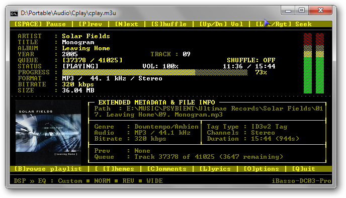
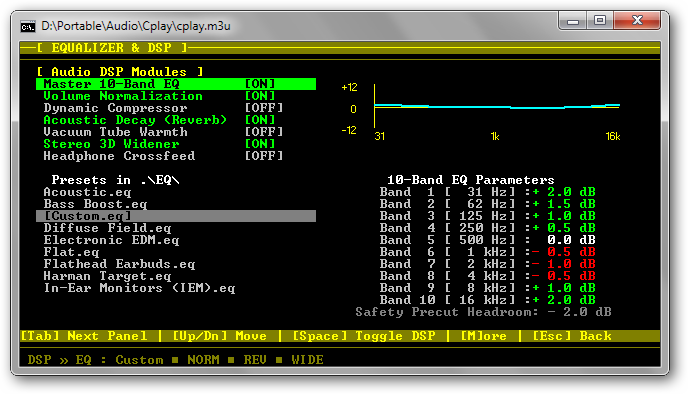
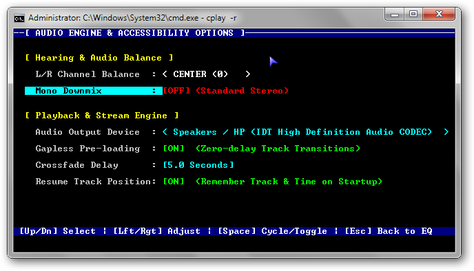

# CPlay - Fast Console Audio Player

A lightweight retro console audio player built in **IWBasic 2.5**. Powered by the Un4seen BASS audio engine (`bass.dll` and `bassflac.dll`), **CPlay** pairs a high-performance CP437 retro text HUD with advanced real-time DSP, 10-Band ISO equalizing, dynamic album art rendering, and synchronized LRC lyrics.

---

## 📸 Screenshots

| Player Main HUD | Equalizer & DSP Engine | Extended Audio Settings |
| :---: | :---: | :---: |
|  |  |  |

---

## ✨ Features

* **Audio Engine & Format Support**
  * Powered by Un4seen BASS & BASS_FLAC sound libraries.
  * Hardware-accelerated playback for **MP3**, **FLAC**, and **M3U** playlists.
  * Automatic recursive directory scanning (`*.mp3`, `*.flac`) and wildcard pattern matching.

* **10-Band ISO Graphic Equalizer Engine**
  * Real-time 10-Band parametric EQ (31 Hz – 16 kHz).
  * $0.5\text{ dB}$ fine-stepping gain control per band ($\pm 12.0\text{ dB}$).
  * Profile preset system (`.eq` format) with built-in presets (*Harman Target, Diffuse Field, EDM, Vocal, Flathead Earbuds*, etc.).
  * **Automatic Headroom Safety Precut**: Calculates peak positive gain in real time to prevent digital clipping distortion.
  * Real-time GDI+ frequency response graph rendering.

* **Custom PCM DSP Suite (`BASS_ChannelSetDSP`)**
  * **Analog Vacuum Tube Warmth**: Polynomial soft-clipper saturation curve ($y = 1.5 \cdot (x - x^3 / 3)$) providing warm analog harmonic saturation.
  * **Stereo 3D Widener**: Real-time Mid-Side matrixing with a 1.6x side-channel boost.
  * **Dynamic Compressor**: Fast-transient attack/release ratio control for loudness smoothing.
  * **Acoustic Decay (Reverb)**: Customizable ambient spatial reverb.
  * **Volume Normalization**: RMS amplitude compensation.

* **Visual Experience & Interface**
  * Dual-buffer isolated console pipeline eliminating screen flicker.
  * Real-time double-tower 10-block vertical VU meters.
  * Integrated Cover Art display (extracts internal ID3v2/FLAC APIC tags or scans local folder images).
  * Marquee text scrolling for long Track/Artist/Album strings.
  * 7 customizable color themes (*Retro Default, Matrix Terminal, Amber CRT, Vaporwave, Cyberpunk, Blood Moon, Classic Monochrome*).

* **Lyrics & Metadata Tracking**
  * **Synchronized LRC Lyrics Engine**: Auto-centers and scrolls active lyric lines in real time based on audio timestamp cues.
  * Full Vorbis Comment, ID3v2, and ID3v1 tag parsing.
  * Embedded and external text reader for song comments and static lyrics.

* **Engine & Accessibility Options**
  * Master L/R Channel Balance slider (-100 Left to +100 Right).
  * Real-time Mono Downmix (summing L+R channels).
  * Live Audio Output Device selector.
  * Zero-delay Gapless pre-loading and smooth Dual-Stream Crossfading (0 to 5 seconds).
  * Session State Persistence (`cplay.ini`): Option to remember exact track and position on shutdown (`-r`).

---

## ⌨️ Controls & Hotkeys

### Main Player View
| Key | Action |
| :--- | :--- |
| `SPACE` | Play / Pause playback |
| `LEFT` / `RIGHT` | Seek backward / forward 5 seconds |
| `UP` / `DOWN` | Increase / Decrease volume |
| `N` / `P` | Next track / Previous track |
| `S` | Toggle Shuffle mode ON / OFF |
| `T` | Cycle Color Themes |
| `C` | Toggle Comments / Extended Metadata Panel |
| `L` | Toggle Lyrics View |
| `O` | Open Equalizer & DSP Options Screen |
| `Q` / `ESC` | Exit CPlay |

### Equalizer & DSP Screen (`Options 1`)
| Key | Action |
| :--- | :--- |
| `TAB` | Cycle focus: **[0] DSP Modules** $\rightarrow$ **[1] EQ Presets** $\rightarrow$ **[2] 10-Band Form** |
| `UP` / `DOWN` | Navigate items or EQ Bands |
| `LEFT` / `RIGHT` | Adjust focused EQ Band Gain ($\pm 0.5\text{ dB}$) |
| `SPACE` | Toggle focused Audio DSP module ON / OFF |
| `ENTER` | Apply selected `.eq` preset profile |
| `S` | Save current EQ gains to a custom `.eq` file |
| `M` | Switch to Extended Audio Engine Options (`Options 2`) |
| `ESC` | Return to Main Player View |

### Extended Audio Settings (`Options 2`)
| Key | Action |
| :--- | :--- |
| `UP` / `DOWN` | Select option row |
| `LEFT` / `RIGHT` | Adjust Channel Balance, Crossfade seconds, or Output Device |
| `SPACE` | Toggle selected option |
| `ESC` | Return to Equalizer & DSP Screen |

---

## 🚀 Usage

Launch **CPlay** from the Command Prompt or Terminal:

```cmd
:: Play a single audio file
cplay.exe "C:\Music\Track01.flac"

:: Load an M3U playlist
cplay.exe "C:\Music\Favorites.m3u"

:: Recursively scan and play a directory
cplay.exe "C:\Music\*.mp3"

:: Resume last session (loads cplay.m3u & restores track position)
cplay.exe -r
```

---

## 🛠️ Building from Source

### Prerequisites
* **Compiler**: IWBasic 2.5 (or higher)
* **Libraries**: `bass.lib`, `bassflac.lib`, `ctl.lib`, `gdiplus.lib`, `normaliz.lib`
* **Includes**: `windowssdk.inc`, `fletchie_ctl.inc`, `bass22.inc`, `gdiplus.inc`
* **DLL Dependencies**: Place `bass.dll` and `bassflac.dll` in the application root folder.

### Build Command
Compile `CP_3.iwb` directly via the IWBasic IDE.
```

---

## 📄 License

This project is open-source. BASS audio library binaries (`bass.dll`, `bassflac.dll`) are property of Un4seen Developments.
